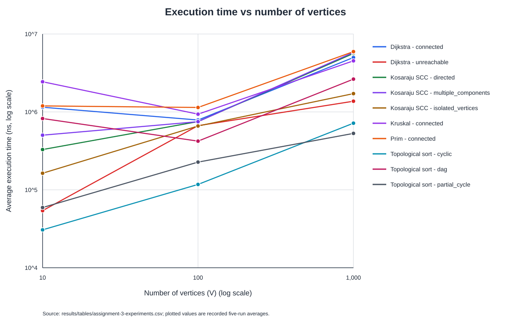
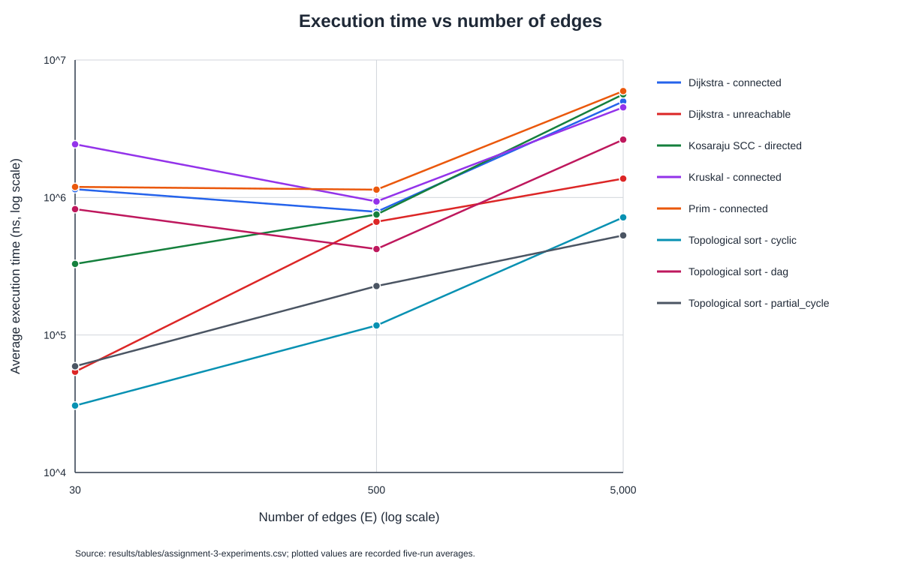

# Design and Analysis of Algorithms — Assignment 3

## Overview

This Java 17 Maven project implements graph data structures and algorithms for minimum spanning trees, directed graph connectivity, and single-source shortest paths. It also includes seeded graph generators, operation counters, and a CSV-based experiment runner.

## Algorithms and implementation

Graphs use adjacency lists. `WeightedGraph` is undirected, stores non-negative integer weights, and allows parallel edges. `DirectedGraph` stores directed adjacency lists. The Disjoint Set Union (DSU) uses path compression and union by size.

| Algorithm | Implementation | Time complexity |
|---|---|---|
| DSU `find` / `union` | Path compression and union by size | Amortized O(α(V)) per operation over a sequence of operations |
| Kruskal MST | Sorts edges by weight and uses DSU to reject cycle-forming edges | O(E log E) |
| Prim MST | Grows each component using a priority queue of candidate edges | O(V + E log(E + 1)) |
| Topological sort | Kahn's algorithm with indegree tracking | O(V + E) |
| Strongly connected components | Iterative two-pass Kosaraju algorithm | O(V + E) |
| Dijkstra | Adjacency lists and a binary priority queue; stale queue entries are skipped | O(V + E log(E + 1)) |

Here, V is the number of vertices, E is the number of edges, and α is the inverse Ackermann function. The priority-queue bounds account for duplicate candidate entries.

## Experiments

The experiment runner generates graphs before timing. Each algorithm is run five times on each graph, and the reported average is measured with `System.nanoTime()`. Operation counters are collected in a separate instrumented run and are not included in the timed measurements.

The required graph sizes are V=10, E=30; V=100, E=500; and V=1,000, E=5,000. The random seed used for the results below is 42.

Scenarios describe the graph used:

- `connected`: connected undirected weighted graphs for MST and Dijkstra.
- `dag`: directed acyclic graphs for topological sorting.
- `cyclic`: directed graphs containing a cycle through every vertex; used for topological sorting and SCC.
- `partial_cycle`: a smaller directed cycle and an acyclic chain region, so Kahn's algorithm processes part of the graph before getting stuck. The regions are not necessarily disconnected components.
- `directed`: the existing strongly connected directed graph used for SCC.
- `multiple_components`: three nontrivial strongly connected components with edges between components only in one direction.
- `isolated_vertices`: a strongly connected core plus isolated vertices with no incoming or outgoing edges.
- `unreachable`: an undirected weighted graph with the last vertex isolated from source vertex 0 for Dijkstra.

### Average execution time

Values below are the recorded `average_elapsed_time_ns` values from [`assignment-3-experiments.csv`](results/tables/assignment-3-experiments.csv). Each combination is a separate algorithm/scenario result.

| Algorithm | Scenario | V | E | Average time (ns) |
|---|---|---:|---:|---:|
| Kruskal | connected | 10 | 30 | 2,438,360 |
| Prim | connected | 10 | 30 | 1,194,060 |
| Topological sort | dag | 10 | 30 | 822,660 |
| Topological sort | cyclic | 10 | 30 | 30,660 |
| Topological sort | partial_cycle | 10 | 30 | 59,240 |
| Kosaraju SCC | directed | 10 | 30 | 328,860 |
| Dijkstra | connected | 10 | 30 | 1,148,660 |
| Dijkstra | unreachable | 10 | 30 | 54,060 |
| Kruskal | connected | 100 | 500 | 935,800 |
| Prim | connected | 100 | 500 | 1,140,260 |
| Topological sort | dag | 100 | 500 | 421,760 |
| Topological sort | cyclic | 100 | 500 | 117,300 |
| Topological sort | partial_cycle | 100 | 500 | 226,920 |
| Kosaraju SCC | directed | 100 | 500 | 751,760 |
| Dijkstra | connected | 100 | 500 | 786,760 |
| Dijkstra | unreachable | 100 | 500 | 666,200 |
| Kruskal | connected | 1,000 | 5,000 | 4,524,060 |
| Prim | connected | 1,000 | 5,000 | 5,941,940 |
| Topological sort | dag | 1,000 | 5,000 | 2,635,260 |
| Topological sort | cyclic | 1,000 | 5,000 | 716,720 |
| Topological sort | partial_cycle | 1,000 | 5,000 | 530,020 |
| Kosaraju SCC | directed | 1,000 | 5,000 | 5,628,780 |
| Dijkstra | connected | 1,000 | 5,000 | 4,993,460 |
| Dijkstra | unreachable | 1,000 | 5,000 | 1,371,720 |

### SCC scenarios

The existing `directed` SCC benchmark is unchanged. The two additional scenarios use the same three graph sizes and five timed repetitions. `multiple_components` has three nontrivial SCCs; any edges between them point in one direction, so the SCCs remain distinct. `isolated_vertices` has a strongly connected core and at least two vertices with no incident edges. Both scenarios preserve the configured vertex and edge counts.

The instrumented `edgesExamined` count includes first-pass DFS scans, edges scanned while constructing the transpose, and second-pass DFS scans; for these graphs it is three times the edge count. The existing `directed` SCC timing values are unchanged, and their edge counters have been normalized to this same definition. Both plots include all ten algorithm/scenario groups from the CSV. The six appended records in [`assignment-3-experiments.csv`](results/tables/assignment-3-experiments.csv) are:

| Scenario | V | E | Average time (ns) | Edges examined |
|---|---:|---:|---:|---:|
| multiple_components | 10 | 30 | 502,980 | 90 |
| isolated_vertices | 10 | 30 | 163,340 | 90 |
| multiple_components | 100 | 500 | 749,660 | 1,500 |
| isolated_vertices | 100 | 500 | 659,600 | 1,500 |
| multiple_components | 1,000 | 5,000 | 5,813,620 | 15,000 |
| isolated_vertices | 1,000 | 5,000 | 1,717,260 | 15,000 |

The plots use logarithmic scales on both axes to show the range of measured times.





### DSU optimization comparison

The separate DSU experiment compares four implementations: basic (no optimization), path compression only, union by size only, and both optimizations. On equal-size trees, union by size selects the lower-numbered root as the parent. For each graph size, a seeded `Random` generates one sequence of union operations and connectivity queries; all four variants process that same sequence. Every query result is compared across the variants before measurements are reported.

The experiment uses 1,000, 5,000, and 50,000 operations for the three sizes above, respectively. It times five uninstrumented repetitions with `System.nanoTime()`; DSU initialization is outside the timed interval. A separate instrumented run records find calls, parent-pointer hops during root searches, successful unions, and connectivity queries. Actual parent-pointer changes from union attachments and path compression are counted separately. The measurements are in [`dsu-variants.csv`](results/tables/dsu-variants.csv).

| Variant | V | Operations | Average time (ns) |
|---|---:|---:|---:|
| basic | 10 | 1,000 | 277,840 |
| path compression only | 10 | 1,000 | 256,540 |
| union by size only | 10 | 1,000 | 247,180 |
| path compression and union by size | 10 | 1,000 | 241,980 |
| basic | 100 | 5,000 | 1,562,360 |
| path compression only | 100 | 5,000 | 977,360 |
| union by size only | 100 | 5,000 | 296,060 |
| path compression and union by size | 100 | 5,000 | 201,820 |
| basic | 1,000 | 50,000 | 34,020,960 |
| path compression only | 1,000 | 50,000 | 1,162,700 |
| union by size only | 1,000 | 50,000 | 2,365,040 |
| path compression and union by size | 1,000 | 50,000 | 1,090,360 |

In this seeded workload, the combined variant has the lowest recorded average at each size, although small-run timing can vary with JVM and system effects. These measurements describe this operation sequence and run, not a general performance guarantee.

### Discussion

Most algorithms took longer on the largest graphs, although the measured averages are not strictly increasing at every size. In particular, short runs are sensitive to JVM warm-up and scheduling effects, so these measurements should be treated as observations from this run rather than precise performance predictions. Topological sort on the `cyclic` graphs reports zero processed vertices because each graph's cycle includes every vertex; `partial_cycle` lets the algorithm process an acyclic region before it stalls.

## Build, run, and test

From the project root, compile and run the experiments with the default seed and CSV path:

```text
mvn -q compile
java -cp target/classes com.daa.experiments.ExperimentCli
```

The default seed is 42 and the default output is `results/tables/assignment-3-experiments.csv`. To provide a seed and output path:

```text
java -cp target/classes com.daa.experiments.ExperimentCli 42 results/tables/assignment-3-experiments.csv
```

Run the DSU variant comparison with its default seed and CSV path:

```text
java -cp target/classes com.daa.experiments.DsuExperimentCli
```

The DSU runner also accepts an optional seed and output path, for example:

```text
java -cp target/classes com.daa.experiments.DsuExperimentCli 42 results/tables/dsu-variants.csv
```

Run the JUnit 5 test suite with:

```text
mvn test
```

The latest full test run passed **85 tests**, with 0 failures, 0 errors, and 0 skipped.
